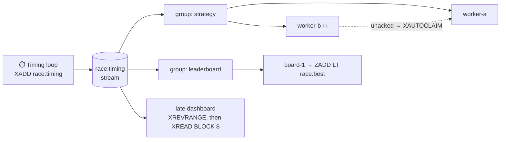

<div align="center">

# 🏁 race-data-redis-streams

**Live timing for every car, delivered to every system that needs it, with nothing lost when a consumer dies.**

[](https://github.com/atonyhonesto/race-data-redis-streams/actions/workflows/ci.yml)


Companion code for my LinkedIn article<br>
**[Race Data Streaming with Redis →](https://www.linkedin.com/pulse/race-data-streaming-redis-tony-honesto-c8dwc/)**

</div>

---

## Why Streams, not pub/sub

Redis pub/sub is fire-and-forget: a subscriber that blinks misses laps forever. A **stream** is an append-only log that keeps entries, so every consumer reads at its own pace, **consumer groups** share the work and track what's been acknowledged, and a dashboard that connects late can **replay** what it missed.



## Run it

```bash
git clone https://github.com/atonyhonesto/race-data-redis-streams.git
cd race-data-redis-streams
python demo.py          # starts a throwaway redis-server if one is installed
# or point it at any Redis 6.2+:
docker run -d -p 6379:6379 redis:7
REDIS_URL=redis://127.0.0.1:6379 python demo.py
python -m unittest -v   # 7 tests against a real Redis
```

Real output:

```text
Redis 7.0.15 at redis://127.0.0.1:55815

1. Timing loop publishes 40 laps with XADD (stream length 40)

2. Group 'strategy' splits the work: worker-a took 10 (acked), worker-b took 10 then crashed
   XPENDING: 10 delivered but unacknowledged -> {'worker-b': 10}

3. worker-a finishes the 20 remaining laps, then XAUTOCLAIMs worker-b's 10 stale ones
   XPENDING now: 0  -> every lap handled once the group settles (at-least-once)

4. Group 'leaderboard' independently reads all 40 laps from the same stream
   P1  car 24  best 40.365 s
   P2  car 77  best 40.486 s
   P3  car  5  best 40.503 s
   P4  car 48  best 40.978 s

5. A dashboard joins late: XREVRANGE for the last 4 laps, then it would XREAD BLOCK from '$'
   1791456890307-4  car 77  lap 10  40.486 s
   1791456890307-3  car 48  lap 10  41.427 s
   1791456890307-2  car 24  lap 10  40.982 s
   1791456890307-1  car  5  lap 10  40.857 s

6. XINFO GROUPS
   leaderboard  consumers 1  pending 0  last-delivered 1791456890307-4  lag 0
   strategy     consumers 2  pending 0  last-delivered 1791456890307-4  lag 0
```

## Commands used, and why

| Command | Job here |
|---|---|
| `XADD race:timing MAXLEN ~ 10000 * …` | Append a lap. `MAXLEN ~` caps memory cheaply (approximate trimming) |
| `XGROUP CREATE … MKSTREAM` | Durable consumer group; start at `0` (history) or `$` (new only) |
| `XREADGROUP GROUP g c COUNT n [BLOCK ms] STREAMS race:timing >` | Get entries never delivered to this group; `BLOCK` waits for new laps without polling |
| `XACK` | Done with it. Unacked entries stay in the pending list |
| `XPENDING` | Who's holding what: how you notice a dead worker |
| `XAUTOCLAIM` | Take over entries idle longer than a threshold |
| `XREVRANGE + - COUNT n` | Replay recent history for a late joiner |
| `ZADD race:best LT` | Leaderboard that only ever improves a car's best lap |
| `XINFO GROUPS` | Pending count, last delivered ID and lag per group |

## Design notes

- **At-least-once.** A crash between processing and `XACK` means the lap is processed again after the claim. Make handlers idempotent (the `ZADD LT` leaderboard is naturally).
- **Groups are independent.** Strategy and leaderboard both see every lap; adding a third consumer type doesn't touch the others.
- **IDs are time-ordered** (`<ms>-<seq>`), so a range query by time needs no extra index.
- **The client is ~50 lines** ([`resp.py`](racestream/resp.py)) to show how simple RESP is. In an application use `redis-py`, StackExchange.Redis or ioredis: same commands, with pooling and reconnects.

## Project layout

```text
racestream/
  resp.py      minimal RESP2 client
  timing.py    producer, groups, read/ack, claim, leaderboard, replay
  server.py    REDIS_URL or a throwaway redis-server
demo.py        the scenario above
tests/         against a real Redis (a service container in CI)
```

---

<sub>Built by **Tony Honesto**, cloud & integration engineer with roots in IndyCar timing & scoring and NASCAR Race Control. More: [github.com/atonyhonesto](https://github.com/atonyhonesto) · [article-labs](https://github.com/atonyhonesto/article-labs) · [LinkedIn](https://www.linkedin.com/in/tony-honesto-4195023)</sub>
